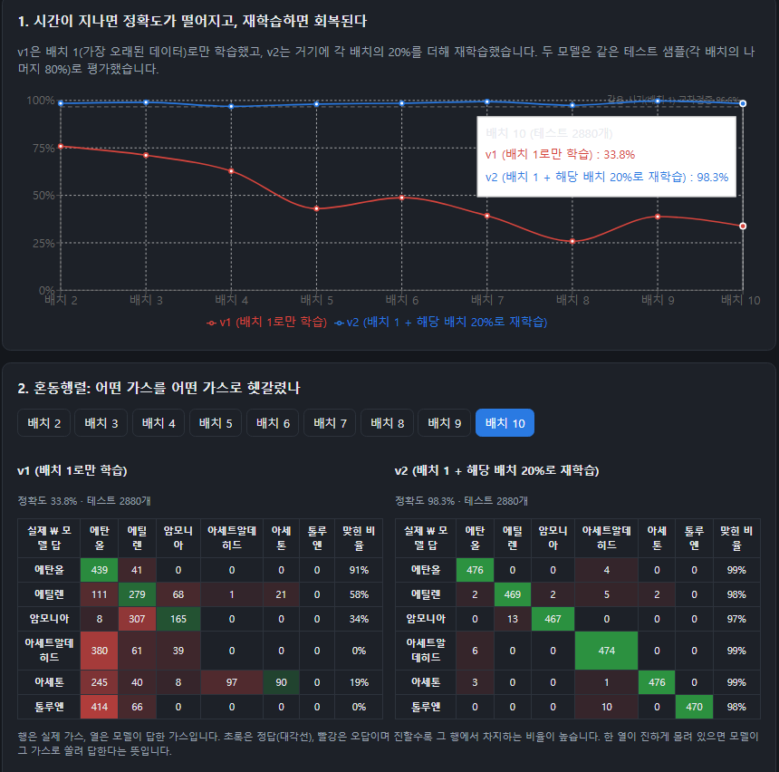
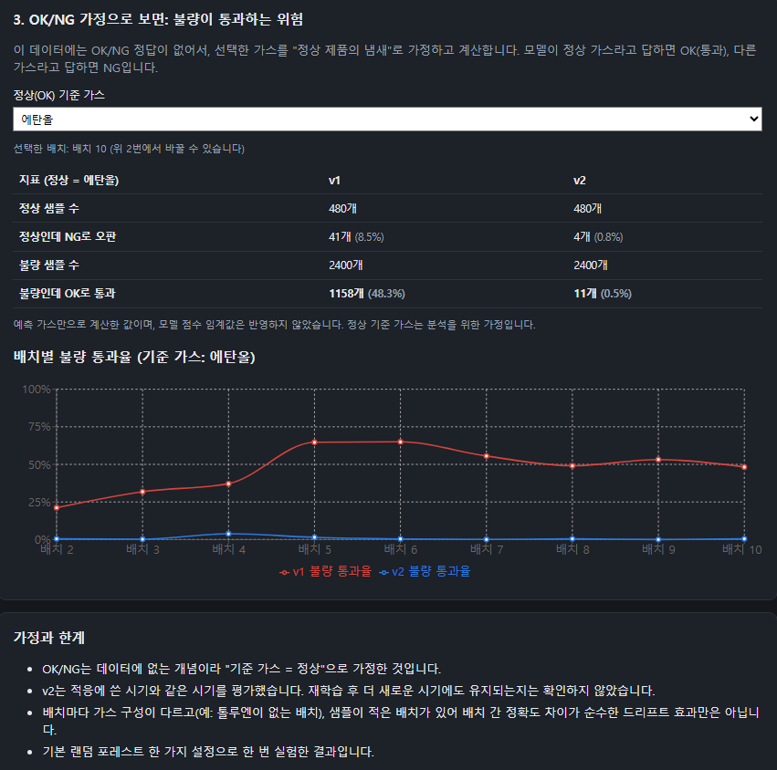
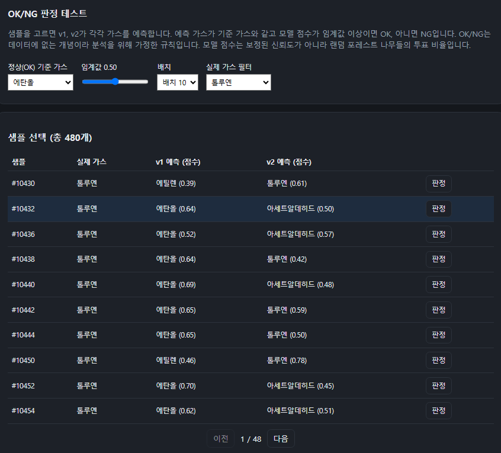
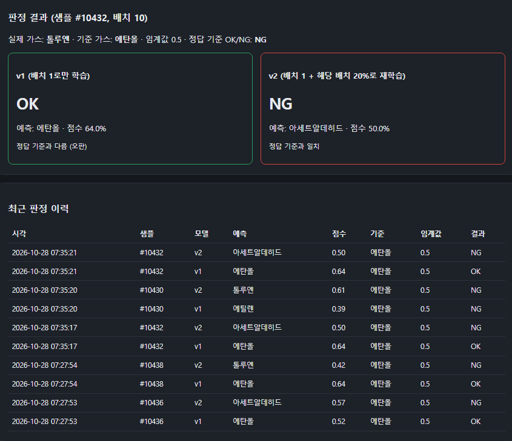
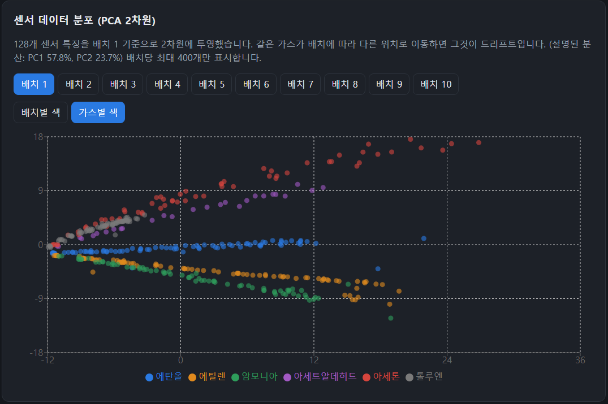
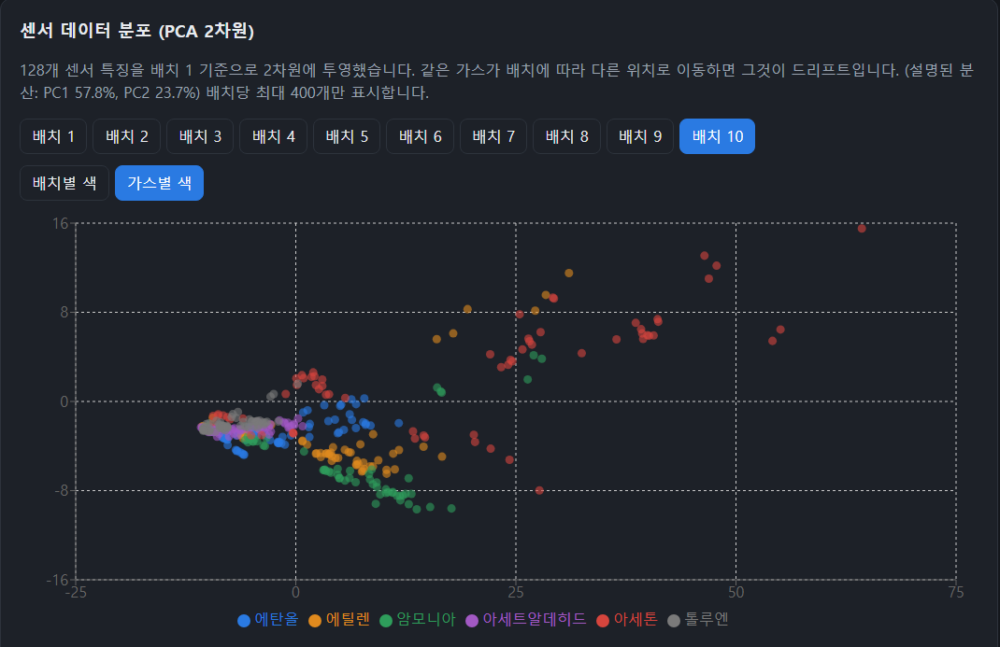

# 전자코 센서 드리프트 분석 및 가스 판정 웹 서비스

센서는 시간이 지나면 같은 가스에도 다르게 반응합니다(센서 드리프트). 이 프로젝트는 **오래된 데이터로만 학습한 모델이 시간이 지난 센서 데이터에서 얼마나 틀리는지, 최신 데이터 일부로 재학습하면 얼마나 회복되는지**를 실험하고, 결과를 웹에서 확인할 수 있게 만든 학습용 프로젝트입니다.

> 후각(전자코) AI를 처음 공부하며 만든 개인 프로젝트입니다. 실험 설계와 한계는 아래에 그대로 적었습니다.

## 화면

### 1. 실험 결과 — 배치별 정확도, 혼동행렬, OK/NG 가정 분석





### 2. 판정 테스트 — 샘플을 골라 v1·v2가 OK/NG를 판정하고 이력을 저장





### 3. 센서 데이터 (PCA) — 같은 가스의 분포가 배치 1과 배치 10에서 달라지는 모습

| 배치 1 | 배치 10 |
|---|---|
|  |  |

## 구조

```
Python 실험 (experiment/)  →  results/*.csv, json
          │ load_results.py
          ▼
     MySQL 8 (db/schema.sql)  ←  Spring Boot REST API (backend/)  ←  React (frontend/)
```

| 폴더 | 내용 |
|---|---|
| `experiment/` | 데이터 확인, 실험(학습·평가), 결과 확인, DB 적재 스크립트 (Python) |
| `results/` | 실험 결과(정확도, 혼동행렬, 예측, PCA 좌표). 원본 데이터 없이도 DB 적재와 화면 확인이 가능합니다 |
| `db/` | MySQL 스키마 |
| `backend/` | Spring Boot, JPA, REST API |
| `frontend/` | React (Vite), Redux Toolkit, Recharts |
| `docker-compose.yml` | MySQL, (선택) 백엔드·프론트 |

## 실험 설계

- 데이터: UCI **Gas Sensor Array Drift Dataset** (13,910개 샘플, 센서 16개 × 특징 8개 = 128개, 가스 6종, 36개월을 10개 배치로 나눔)
- **v1**: 배치 1로만 학습한 랜덤 포레스트(100그루)
- **v2**: 배치 1 + 평가할 배치의 20%로 재학습한 랜덤 포레스트
- 배치 2~10 각각에서, 20%(재학습용)를 뺀 나머지 80%를 **v1과 v2에 똑같이** 평가했습니다 (학습에 쓴 샘플은 평가에서 제외).
- 결과(배치별 정확도, 6×6 혼동행렬, 샘플별 예측과 점수, PCA 좌표)를 MySQL에 저장하고 API로 제공합니다.
- PCA는 배치 1로 학습(StandardScaler + PCA)해서 모든 배치를 같은 축에 투영했습니다.

## 결과 요약

수치는 `results/accuracy.csv`와 `results/confusion.json` 기준입니다(랜덤 시드 42, 한 번 실행).

- 배치 1 안의 5-fold 교차검증 정확도는 **96.6%** 입니다. 드리프트가 없을 때의 기준선입니다.
- v1은 시간이 지날수록 떨어져서 배치 2에서 **75.9%**, 배치 10에서 **33.8%** 입니다.
- v2는 배치 2~10 모두 **96.9~99.7%** 입니다.
- v1은 배치 10에서 2,880개 중 1,597개를 에탄올로 답하고 톨루엔은 한 번도 답하지 않았습니다. 틀리는 방식이 한쪽으로 쏠립니다.
- PCA에서도 배치 1에서는 뚜렷하던 톨루엔·아세트알데히드의 분포가 배치 10에서는 원점 근처로 몰려 다른 가스와 겹칩니다.

### OK/NG 가정

이 데이터에는 OK/NG 정답이 없어서, **선택한 가스를 "정상 제품의 냄새"로 가정**했습니다.

- 예측 가스가 기준 가스와 같고 모델 점수가 임계값 이상이면 OK, 아니면 NG입니다.
- 모델 점수는 랜덤 포레스트 나무들의 투표 비율이며, 보정된 신뢰도가 아닙니다. 임계값은 분석을 위해 가정한 설정값입니다.
- 예) 에탄올을 정상으로 두면 v1은 배치 10에서 **불량의 약 48%를 OK로 통과**시킵니다(예측 가스만 기준).

## 실행 방법

필요한 것: Docker, Python 3.10+, Node.js 20+, JDK 17 (Docker로 전체를 실행하면 Python 외에는 필요 없습니다).

### 1. 가장 빠른 방법: 저장된 결과로 실행 (원본 데이터 불필요)

```bash
# 1) MySQL 실행 (스키마 자동 적용, 호스트 포트 3307)
docker compose up -d

# 2) 결과를 DB에 적재
pip install -r experiment/requirements.txt
python experiment/load_results.py results

# 3-A) 전체를 Docker로 실행
docker compose --profile full up -d --build
#   화면 http://localhost:3000   API http://localhost:8080/api/accuracy

# 3-B) 또는 직접 실행
# 터미널 1
cd backend && ./gradlew bootRun          # Windows: gradlew.bat bootRun
# 터미널 2
cd frontend && npm install && npm run dev  # http://localhost:5173
```

### 2. 실험부터 다시 실행

원본 데이터는 라이선스(CC BY 4.0) 안내만 하고 저장소에는 올리지 않았습니다.
[UCI 페이지](https://archive.ics.uci.edu/dataset/270/gas+sensor+array+drift+dataset)에서 받아 `data/` 폴더에 `batch1.dat ~ batch10.dat`를 넣으세요. 저장소 최상위에서 실행합니다.

```bash
python experiment/check_data.py data            # 배치별 샘플 수 확인, gas_drift.npz 생성
python experiment/run_experiment.py             # results/ 생성
python experiment/show_confusion.py results 10  # 혼동행렬 출력 (배치 10)
python experiment/load_results.py results       # DB 적재
```

## API

| 메서드 | 주소 | 설명 |
|---|---|---|
| GET | `/api/accuracy` | 배치별 정확도 (v1, v2, v1 교차검증) |
| GET | `/api/confusion` | 배치별 혼동행렬 |
| GET | `/api/pca?batches=1,10&max=400` | PCA 좌표 |
| GET | `/api/samples?batch=&label=&page=&size=` | 샘플별 예측 결과 |
| GET | `/api/meta` | 가스 이름, 실험 메타 정보 |
| POST | `/api/judgements` | 샘플 판정 (`sampleId`, `referenceGas`, `threshold`) 후 이력 저장 |
| GET | `/api/judgements` | 판정 이력 |

## 가정과 한계

- **OK/NG는 가정**입니다. 실제 품질 판정 데이터가 아니라, 기준 가스를 정상으로 둔 분석용 규칙입니다.
- **v2는 적응에 쓴 시기와 같은 시기를 평가**했습니다. 재학습한 뒤 더 새로운 시기에도 유지되는지는 확인하지 않았습니다.
- 배치마다 가스 구성과 샘플 수가 다릅니다(예: 톨루엔이 없는 배치, 샘플이 적은 배치). 배치 간 정확도 차이가 순수한 드리프트 효과만은 아닙니다.
- 배치는 월을 묶은 것이라 완전한 시간 순서가 아닙니다.
- 랜덤 포레스트 기본 설정으로 시드 하나만 사용했습니다. 여러 시드 평균이나 다른 모델과의 비교는 하지 않았습니다.
- PCA는 2차원 투영이라 정보가 일부 사라집니다. 그림에서 겹쳐 보여도 실제로 구분이 불가능하다는 뜻은 아닙니다.
- 판정 테스트는 데이터셋의 실제 측정 샘플을 고르는 방식이며, 센서 값을 직접 입력하는 기능은 없습니다.
- `docker-compose.yml`의 DB 계정은 **로컬 연습용 값**입니다. 외부에 공개하는 환경에서는 사용하지 마세요.

## 데이터 출처와 라이선스

- Vergara, A., Vembu, S., Ayhan, T., Ryan, M. A., Homer, M. L., Huerta, R. (2012). *Chemical gas sensor drift compensation using classifier ensembles.* Sensors and Actuators B: Chemical, 166-167, 320-329. doi:10.1016/j.snb.2012.01.074
- Rodriguez-Lujan, I., Fonollosa, J., Vergara, A., Homer, M., Huerta, R. (2014). *On the calibration of sensor arrays for pattern recognition using the minimal number of experiments.* Chemometrics and Intelligent Laboratory Systems, 130, 123-134.
- 데이터: UCI Machine Learning Repository, CC BY 4.0
